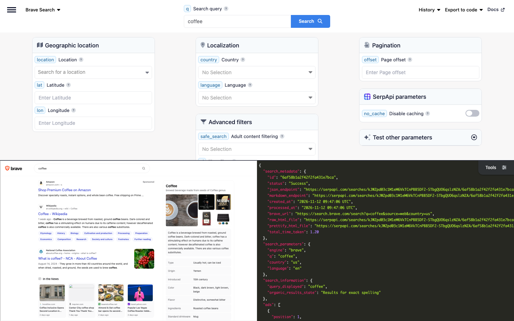

# Brave Scraper

Scrape Brave Search results with SerpApi's Brave Search API. Search the web in any of Brave's countries and languages, or near any location, and get each result's title, link, snippet, date, thumbnail, sitelinks, and rich snippets, plus the ads, knowledge graph, local results, news, videos, images, discussions, related questions, recipes, and related searches on the page.

## How to scrape Brave Search results

Search Brave with a simple GET request:

```text
https://serpapi.com/search?engine=brave&q=coffee&api_key=SERPAPI_API_KEY
```

- `q` is the search query: anything you'd use in a regular Brave search, including `site:` and other search operators. Brave doesn't support `intitle:` or `intext:`, so use `inpage:` instead.
- `api_key` is your SerpApi API key. Replace `SERPAPI_API_KEY` with it.
- `location` sets where the search originates, e.g., `New York, New York, United States`. Use `lat` and `lon` instead to set GPS coordinates.
- `country` and `language` set Brave's region and language, e.g., `de` and `de` for Germany in German. They default to `us` and `en`.
- `tf` limits the results to the past day, week, month, or year, or to a date range, e.g., `2025-01-01to2025-03-31`.
- `safe_search` filters adult content: `off`, `moderate` (default), or `strict`.
- `offset` gets the next pages of results, from `0` to `5`. Brave returns up to 20 results per page.

Without `location`, `lat`, and `lon`, Brave localizes the results to a city in the United States that can change from one search to the next, whatever the `country`. Set `location` for queries with a local intent, such as pizza near me. Ads come from Brave's US market whatever the `country`.

[Register at SerpApi](https://serpapi.com?utm_source=github_brave_scraper) to get your API key, and keep it private.

### Playground

Try the request live in the [SerpApi Playground](https://serpapi.com/playground?engine=brave&q=coffee&utm_source=github_brave_scraper).

[](https://serpapi.com/playground?engine=brave&q=coffee&utm_source=github_brave_scraper)

## Code examples

The code examples read your API key from the `SERPAPI_API_KEY` environment variable:

```bash
export SERPAPI_API_KEY="SERPAPI_API_KEY"
```

Each example searches Brave for coffee and prints the position, title, and link of each result on the first page.

### curl integration

Send the request with curl, which prints the full JSON response:

```bash
curl --get https://serpapi.com/search \
 --data-urlencode engine="brave" \
 --data-urlencode q="coffee" \
 --data-urlencode api_key="$SERPAPI_API_KEY"
```

### JavaScript integration

Install the [SerpApi JavaScript library](https://github.com/serpapi/serpapi-javascript) and set your project to use ES modules:

```bash
npm install serpapi
npm pkg set type=module
```

Create an `index.js` file:

```javascript
import { getJson } from "serpapi";

const results = await getJson({
  engine: "brave",
  api_key: process.env.SERPAPI_API_KEY,
  q: "coffee",
});

for (const result of results.organic_results ?? []) {
  console.log(result.position, result.title, result.link);
}
```

Run it with `node index.js`.

### Python integration

Install the [SerpApi Python library](https://github.com/serpapi/serpapi-python):

```bash
pip install serpapi
```

Create a `main.py` file:

```python
import os
import serpapi

client = serpapi.Client(api_key=os.getenv("SERPAPI_API_KEY"))
results = client.search({
    "engine": "brave",
    "q": "coffee",
})

for result in results.get("organic_results", []):
    print(result["position"], result.get("title"), result["link"])
```

Run it with `python main.py`.

### Ruby integration

Install the [SerpApi Ruby library](https://github.com/serpapi/serpapi-ruby):

```bash
gem install serpapi
```

Create a `main.rb` file:

```ruby
require "serpapi"

client = SerpApi::Client.new(engine: "brave", api_key: ENV.fetch("SERPAPI_API_KEY"))
results = client.search(q: "coffee")

results.fetch(:organic_results, []).each do |result|
  puts "#{result[:position]} #{result[:title]} #{result[:link]}"
end

client.close
```

Run it with `ruby main.rb`.

### PHP integration

Install the [SerpApi PHP library](https://github.com/serpapi/serpapi-php):

```bash
composer require serpapi/serpapi-php
```

Create an `index.php` file:

```php
<?php
require 'vendor/autoload.php';

use SerpApi\Client;

$client = new Client(getenv('SERPAPI_API_KEY'), 'brave');
$results = $client->search([
  'q' => 'coffee',
]);

foreach ($results->organic_results ?? [] as $result) {
  echo $result->position . ' ' . ($result->title ?? '') . ' ' . $result->link . PHP_EOL;
}
```

Run it with `php index.php`.

### Go integration

Create a Go module and install the [SerpApi Go library](https://github.com/serpapi/serpapi-golang):

```bash
go mod init example.com/brave
go get github.com/serpapi/serpapi-golang
```

Create a `main.go` file:

```go
package main

import (
	"fmt"
	"os"

	"github.com/serpapi/serpapi-golang"
)

func main() {
	setting := serpapi.NewSerpApiClientSetting(os.Getenv("SERPAPI_API_KEY"))
	setting.Engine = "brave"
	client := serpapi.NewClient(setting)

	results, err := client.Search(map[string]string{
		"q": "coffee",
	})
	if err != nil {
		panic(err)
	}

	organicResults, _ := results["organic_results"].([]interface{})
	for _, item := range organicResults {
		result := item.(map[string]interface{})
		fmt.Println(result["position"], result["title"], result["link"])
	}
}
```

Run it with `go run .`.

### Rust integration

Create a Cargo project and add the [SerpApi Rust library](https://github.com/serpapi/serpapi-rust) and Tokio:

```bash
cargo new brave && cd brave
cargo add serpapi tokio --features tokio/full
```

Replace `src/main.rs` with:

```rust
use serpapi::serpapi::Client;
use std::collections::HashMap;
use std::env;

#[tokio::main]
async fn main() -> Result<(), Box<dyn std::error::Error>> {
    let mut default = HashMap::new();
    default.insert("api_key".to_string(), env::var("SERPAPI_API_KEY")?);
    default.insert("engine".to_string(), "brave".to_string());
    let client = Client::new(default)?;

    let mut parameter = HashMap::new();
    parameter.insert("q".to_string(), "coffee".to_string());

    let results = client.search(parameter).await?;
    if let Some(organic_results) = results["organic_results"].as_array() {
        for result in organic_results {
            println!(
                "{} {} {}",
                result["position"],
                result["title"].as_str().unwrap_or_default(),
                result["link"].as_str().unwrap_or_default()
            );
        }
    }
    Ok(())
}
```

Run it with `cargo run`.

### Other programming languages

Official libraries are also available for [Java](https://github.com/serpapi/serpapi-java), [.NET](https://github.com/serpapi/serpapi-dotnet), [Swift](https://github.com/serpapi/serpapi-swift), and [C++](https://github.com/serpapi/serpapi-cpp). See [SerpApi integrations](https://serpapi.com/integrations?utm_source=github_brave_scraper) for setup guides, or use a simple GET request from any programming language.

### Errors

Failed requests return an HTTP error status and a JSON body with an `error` message. The most common are `401` for an invalid API key, `400` for a missing or invalid parameter, e.g., no `q`, an `offset` above `5`, or `location` together with `lat` and `lon`, and `429` when you exceed your hourly throughput limit or run out of searches. See [API status and error codes](https://serpapi.com/api-status-and-error-codes?utm_source=github_brave_scraper) for the full list.

A search without results, e.g., `site:` with a domain Brave doesn't know, still returns `200`, with `search_metadata.status` set to `Success`, `search_information.organic_results_state` set to `Fully empty`, and the error "Brave Search hasn't returned any results for this query." Brave matches most unusual queries loosely, so this is rare, but check for `error` before reading `organic_results`.

## Output formats: JSON and Markdown

Choose structured JSON for applications or Markdown for LLMs and AI agents:

- JSON is the default output and is useful when you need individual result fields.
- Add `output=md` to receive Markdown instead, which is more token-efficient.

Markdown is plain text, not JSON: YAML front matter with the search metadata, followed by the search information, the knowledge graph, tables of the ads, results, news, discussions, related questions, videos, and local places, a list of related searches, and a link to the next page. Read the response body as text instead of parsing it.

| Client | Markdown request |
|--------|------------------|
| curl | `--data-urlencode output="md"` |
| Python | `client.search({..., "output": "md"})` |
| PHP | `$client->md([...])` |
| Go | `client.Md(map[string]string{...})` |
| Rust | `client.md(parameter).await?` |

If your SDK doesn't have a Markdown helper yet, send a plain HTTP request with `output=md` and read the body as text. Learn more about [Markdown output](https://serpapi.com/markdown-output?utm_source=github_brave_scraper).

## Brave Search API parameters

See the [Brave Search API documentation](https://serpapi.com/brave-search-api?utm_source=github_brave_scraper) for more details.

| Name | Description | Requirement |
|------|-------------|-------------|
| **Search query** | | |
| `q` | The search query: anything you'd use in a regular Brave search (e.g., `coffee`), including `site:` and other search operators. `intitle:`, `intext:`, `inurl:`, and `inanchor:` (and `allintitle:` and the like) aren't supported: use `inpage:` to search in the titles and bodies of pages, or `inbody:` to search in their bodies. `site:` can't be followed by a dot: use `site:gov` instead of `site:.gov`. | Required |
| **Geographic location** | | |
| `location` | Where the search originates (e.g., `New York, New York, United States`). If several locations match, SerpApi picks the most popular one. Use the [Locations API](https://serpapi.com/locations-api?utm_source=github_brave_scraper) for more precise control. Without `location`, `lat`, and `lon`, the results are localized to a city in the United States that can change from one search to the next. Can't be used with `lat` and `lon`. | Optional |
| `lat` | The GPS latitude of the search origin (e.g., `51.5074`). Requires `lon`. Can't be used with `location`. | Optional |
| `lon` | The GPS longitude of the search origin (e.g., `-0.1278`). Requires `lat`. Can't be used with `location`. | Optional |
| **Localization** | | |
| `country` | The country to use for the search, as a two-letter country code (e.g., `us`, `gb`, `fr`), or `all` for all regions. Defaults to `us`. See [Brave countries](https://serpapi.com/brave-countries?utm_source=github_brave_scraper) for supported countries. | Optional |
| `language` | The language of the dates and labels, and the default language of the results, as a two-letter language code (e.g., `en`, `es`, `fr`). Defaults to `en`. See [Brave languages](https://serpapi.com/brave-languages?utm_source=github_brave_scraper) for supported languages. | Optional |
| **Advanced filters** | | |
| `safe_search` | The level of adult content filtering: `off`, `moderate` (default), or `strict`. | Optional |
| `tf` | The time period of the results: `pd` for the past day, `pw` for the past week, `pm` for the past month, `py` for the past year, or a date range as `YYYY-MM-DDtoYYYY-MM-DD` (e.g., `2025-01-01to2025-03-31`). Defaults to any time. | Optional |
| `spellcheck` | Set to `0` to search the query as typed, or `1` to let Brave correct its spelling (default). | Optional |
| **Pagination** | | |
| `offset` | The page of results (e.g., `0` for the first page, `1` for the second), up to `5`, the last page Brave offers. Defaults to `0`. Brave returns up to 20 results per page. | Optional |
| **SerpApi parameters** | | |
| `engine` | Set to `brave`. | Required |
| `api_key` | Your private SerpApi API key. | Required |
| `no_cache` | Set to `true` to request fresh results instead of using the one-hour cache. Can't be combined with `async`. | Optional |
| `async` | Set to `true` for later retrieval through the [Searches Archive API](https://serpapi.com/search-archive-api?utm_source=github_brave_scraper). Can't be combined with `no_cache` or used with Ludicrous Speed enabled. | Optional |
| `zero_trace` | Enterprise only. Set to `true` to skip storing search parameters, files, and metadata on SerpApi servers. | Optional |
| `output` | Set to `json` (default), `html` for the raw HTML retrieved, or `md` for Markdown. | Optional |
| `json_restrictor` | Limit the JSON response to the fields you need. See the [JSON Restrictor](https://serpapi.com/json-restrictor?utm_source=github_brave_scraper) documentation. | Optional |

## Available data on Brave Search results (JSON response)

Each item in `organic_results` is a web page. Depending on the query, the page can also include `ads`, a `knowledge_graph`, `local_results`, `news_results`, `inline_videos`, `inline_images`, `discussions_and_forums`, `related_questions`, `recipes_results`, and `related_searches`. The field guides below describe the possible fields and their types; they aren't literal API responses.

### What you get depends on the query

Some sections and fields appear only when Brave shows them:

| Query | Sections and fields |
|-------|---------------------|
| A person, a company, a place, or a thing | `knowledge_graph`, e.g., Coffee, with its facts in `attributes` and its profiles on other websites |
| A movie | `knowledge_graph.ratings`, e.g., 8.8 on IMDb, and the directors, actors, and release date in the `rich_snippet` of the results |
| A programming question | `knowledge_graph` with a Stack Overflow question and its `answers`, and `answers` in the Stack Overflow and Reddit results |
| A query with a local intent, e.g., pizza near me | `local_results` with up to 100 places, and the address, phone, and cuisine of restaurants in the `rich_snippet` of the results |
| A topic in the news | `news_results` |
| A product | `ads`, a `carousel` of products with prices in some results, and prices in `rich_snippet` |
| A recipe | `recipes_results`, and the rating, total time, and calories in the `rich_snippet` of the results |
| A query for pictures, e.g., eiffel tower pictures | `inline_images` |
| A misspelled query, e.g., cofee beens | `search_information.spelling_fix`, e.g., coffee beans, with the results for the corrected query |
| A website, e.g., amazon | `sitelinks.expanded` with the main pages of the website |

Many searches also return `inline_videos`, `discussions_and_forums`, `related_questions`, and `related_searches`. Dates are returned as displayed, in the language of the search, e.g., 1 week ago or vor 20 Stunden. To get Brave's AI answers, use the [Brave AI Mode API](https://serpapi.com/brave-ai-mode-api?utm_source=github_brave_scraper).

Brave returns up to 20 results per page and up to 6 pages. To get the next page, increase `offset` by 1 or follow `serpapi_pagination.next`. Positions continue from one page to the next, e.g., 21 for the first result of the second page.

### Organic results

Each result in `organic_results` can include these fields:

```json
{
  "organic_results": [
    {
      "position": "Integer - Position of the result, continuing on the next pages",
      "title": "String - Title of the result",
      "link": "String - Link to the result",
      "displayed_link": "String - Link of the result, as displayed, e.g., en.wikipedia.org › wiki › Coffee",
      "source": "String - Name of the website, e.g., Wikipedia",
      "favicon": "String - Link to the favicon of the website",
      "date": "String - Date of the result, as displayed, e.g., 1 week ago or August 14, 2024",
      "snippet": "String - Snippet of the result",
      "snippet_highlighted_words": "Array[String] - Words in bold in the snippet",
      "thumbnail": "String - Link to the image of the result",
      "sitelinks": {
        "inline": [
          {
            "title": "String - Title of the link, e.g., History",
            "link": "String - Link to a section or a page of the website"
          }
        ],
        "expanded": [
          {
            "title": "String - Title of another page of the website, e.g., Customer Service & Help",
            "link": "String - Link to the page",
            "snippet": "String - Snippet of the page"
          }
        ]
      },
      "carousel": [
        {
          "title": "String - Name of the product, e.g., Cafe Bustelo Medium Roast Ground Coffee, 11 oz Bag",
          "link": "String - Link to the product",
          "thumbnail": "String - Link to the image of the product",
          "rating": "Float - Rating of the product, e.g., 4.7",
          "max_rating": "Integer - Highest possible rating, e.g., 5",
          "price": "String - Price, as displayed, e.g., $8.87",
          "extracted_price": "Float - Price as a number, e.g., 8.87",
          "currency": "String - Currency of the price, e.g., USD"
        }
      ],
      "answers": [
        {
          "answer": "String - Answer from a Q&A website, such as Reddit or Stack Overflow",
          "votes": "Integer - Number of upvotes of the answer",
          "top_answer": "Boolean - true for the top answer"
        }
      ],
      "rich_snippet": {
        "rating": "Float - Rating of the recipe, product, review, movie, or place, e.g., 4.7",
        "max_rating": "Integer - Highest possible rating, e.g., 5, 10, or 100",
        "reviews": "Integer - Number of reviews or votes",
        "price": "String - Price of the product, as displayed, e.g., $49.00",
        "extracted_price": "Float - Price as a number, e.g., 49.0",
        "currency": "String - Currency of the price, e.g., USD",
        "duration": "String - Duration of the video, e.g., 13:01",
        "views": "String - Views of the video, as displayed, e.g., 44K",
        "extracted_views": "Integer - Views of the video as a number, e.g., 44000",
        "total_time": "String - Total time of the recipe, e.g., 30:00 or 02:45:00",
        "calories": "Integer - Calories of the recipe, e.g., 183",
        "detected_extensions": {
          "<label>": "String - Detail of a movie or a place, with keys such as directors, actors, release_date, cuisine, phone, and address"
        }
      }
    }
  ]
}
```

`answers` has the top answer and the next one. On Reddit results, `snippet` is the question, and Stack Overflow results have no `snippet`.

### Ads and knowledge graph

`ads` lists the text ads at the top of the page, and `knowledge_graph` describes the person, company, place, or thing the query is about:

```json
{
  "ads": [
    {
      "position": "Integer - Position of the ad",
      "block_position": "String - Place of the ad on the page, e.g., top",
      "title": "String - Title of the ad, e.g., Shop Premium Coffee on Amazon",
      "link": "String - Link to the landing page of the ad",
      "tracking_link": "String - Brave's tracking link of the ad, which redirects to the landing page",
      "displayed_link": "String - Link of the ad, as displayed, e.g., amazon.com › s",
      "source": "String - Name of the advertiser, e.g., Amazon",
      "description": "String - Description of the ad",
      "favicon": "String - Link to the favicon of the advertiser",
      "thumbnail": "String - Link to the image of the ad, if it has one"
    }
  ],
  "knowledge_graph": {
    "title": "String - Name of the entity, e.g., Coffee",
    "type": "String - Short description of the entity, e.g., brewed beverage made from seeds of Coffea genus",
    "description": "String - Description of the entity",
    "source": {
      "name": "String - Name of the source of the description, e.g., Wikipedia",
      "link": "String - Link to the source of the description"
    },
    "website": "String - Link to the official website of the entity",
    "thumbnail": "String - Link to the image of the entity, when Brave shows one",
    "images": "Array[String] - Links to the images of the entity, when Brave shows several",
    "attributes": {
      "<label>": "String - Fact about the entity, with its label in snake case as the key, e.g., \"origin\": \"Yemen\""
    },
    "profiles": [
      {
        "name": "String - Name of the website, e.g., Wikipedia or IMDb",
        "link": "String - Link to the profile of the entity",
        "thumbnail": "String - Link to the favicon of the website"
      }
    ],
    "ratings": [
      {
        "source": "String - Name of the rating website, e.g., IMDb",
        "rating": "Float - Rating on the website, e.g., 8.8",
        "max_rating": "Integer - Highest possible rating, e.g., 10 or 100",
        "reviews": "Integer - Number of votes or reviews on the website"
      }
    ],
    "question": "String - Question of a Q&A panel, e.g., How do I reverse a list or loop over it backwards?",
    "answers": [
      {
        "answer": "String - Answer to the question",
        "author": "String - Author of the answer"
      }
    ]
  }
}
```

The `attributes` labels are in the language of the search, and an attribute with several values has them on separate lines, e.g., the cast of a movie in `starring`.

### Local results

`local_results.places` lists the places near the location of the search:

```json
{
  "local_results": {
    "places": [
      {
        "position": "Integer - Position of the place",
        "title": "String - Name of the place, e.g., Joe's Pizza",
        "type": "String - Type of the place, e.g., Pizza Restaurant",
        "address": "String - Address of the place, e.g., 124 Fulton St, New York, NY 10038",
        "phone": "String - Phone number, e.g., +12122670860",
        "rating": "Float - Rating, e.g., 4.2",
        "max_rating": "Integer - Highest possible rating, e.g., 5",
        "reviews": "Integer - Number of reviews, e.g., 51",
        "price": "String - Price range, e.g., $ or $$ - $$$",
        "operating_hours": {
          "monday": "String - Opening hours on Monday, e.g., 10:00–03:00, with a key for each day of the week"
        },
        "gps_coordinates": {
          "latitude": "Float - Latitude of the place",
          "longitude": "Float - Longitude of the place"
        },
        "link": "String - Link to the website of the place",
        "thumbnail": "String - Link to the image of the place",
        "distance": "String - Distance from the location of the search, e.g., 0.22 miles"
      }
    ]
  }
}
```

### News, videos, and images

`news_results`, `inline_videos`, and `inline_images` are the news, videos, and images shown between the results:

```json
{
  "news_results": [
    {
      "position": "Integer - Position of the article",
      "title": "String - Title of the article",
      "link": "String - Link to the article",
      "source": "String - Website of the article, e.g., hoodline.com",
      "favicon": "String - Link to the favicon of the website",
      "date": "String - Date of the article, as displayed, e.g., 2 days ago",
      "thumbnail": "String - Link to the image of the article"
    }
  ],
  "inline_videos": [
    {
      "position": "Integer - Position of the video",
      "title": "String - Title of the video",
      "link": "String - Link to the video",
      "thumbnail": "String - Link to the thumbnail of the video",
      "duration": "String - Duration of the video, e.g., 27:47",
      "platform": "String - Platform of the video, e.g., YouTube or facebook.com",
      "date": "String - Date of the video, as displayed, e.g., 1 week ago",
      "views": "Integer - Number of views, e.g., 351"
    }
  ],
  "inline_images": [
    {
      "position": "Integer - Position of the image",
      "title": "String - Title of the image",
      "link": "String - Link to the page of the image",
      "source": "String - Website of the image, e.g., gettyimages.com",
      "thumbnail": "String - Link to the thumbnail of the image",
      "original": "String - Link to the original image",
      "original_width": "Integer - Width of the original image, in pixels",
      "original_height": "Integer - Height of the original image, in pixels"
    }
  ]
}
```

For more images and videos, use the [Brave Images API](https://serpapi.com/brave-images-api?utm_source=github_brave_scraper) and the [Brave Videos API](https://serpapi.com/brave-videos-api?utm_source=github_brave_scraper).

### Discussions and related questions

`discussions_and_forums` lists discussions from Reddit and other forums, and `related_questions` lists questions about the query with their answers:

```json
{
  "discussions_and_forums": [
    {
      "title": "String - Title of the discussion",
      "link": "String - Link to the discussion",
      "source": "String - Forum of the discussion, e.g., r/Coffee or discuss.python.org",
      "date": "String - Date of the discussion, as displayed, e.g., October 11, 2023",
      "comments": "Integer - Number of comments, e.g., 833",
      "votes": "Integer - Number of votes, e.g., 215",
      "snippet": "String - Snippet of the discussion"
    }
  ],
  "related_questions": [
    {
      "question": "String - Question, e.g., Where is coffee grown?",
      "snippet": "String - Answer to the question",
      "title": "String - Title of the page of the answer",
      "link": "String - Link to the page of the answer",
      "displayed_link": "String - Link of the page, as displayed",
      "source_logo": "String - Link to the favicon of the website"
    }
  ]
}
```

### Recipes and related searches

`recipes_results` lists recipes for the query, and `related_searches` lists other searches on Brave:

```json
{
  "recipes_results": [
    {
      "title": "String - Title of the recipe, e.g., Chewy Chocolate Chip Cookies",
      "link": "String - Link to the recipe",
      "source": "String - Website of the recipe, e.g., sallysbakingaddiction.com",
      "rating": "Float - Rating of the recipe, e.g., 4.7",
      "max_rating": "Integer - Highest possible rating, e.g., 5",
      "total_time": "String - Total time of the recipe, e.g., 30:00 or 02:45:00",
      "thumbnail": "String - Link to the image of the recipe"
    }
  ],
  "related_searches": [
    {
      "query": "String - Related search query, e.g., coffee types",
      "link": "String - Link to the search on Brave",
      "serpapi_link": "String - SerpApi link to the search, with the same country, language, and location"
    }
  ]
}
```

### Search information and pagination

`search_information` describes the search, and `serpapi_pagination` links to the other pages:

```json
{
  "search_information": {
    "query_displayed": "String - Query as typed, e.g., cofee beens",
    "spelling_fix": "String - Query Brave corrected the spelling to and searched for instead, e.g., coffee beans",
    "organic_results_state": "String - State of the results: Results for exact spelling, Showing results for fixed spelling, or Fully empty"
  },
  "serpapi_pagination": {
    "current": "Integer - Current page, from 1 to 6",
    "previous": "String - SerpApi link to the previous page",
    "next": "String - SerpApi link to the next page"
  }
}
```

`spelling_fix` is missing when Brave searched for the query as typed, which it always does with `spellcheck` set to `0`. The last page, with `offset` set to `5`, has no `next` link.

## AI agents and no-code

### MCP

Give AI agents and assistants a Brave web search tool with the hosted [SerpApi MCP server](https://github.com/serpapi/serpapi-mcp) at `https://mcp.serpapi.com/mcp`.

Claude Code:

```bash
claude mcp add --transport http serpapi https://mcp.serpapi.com/mcp --header "Authorization: Bearer $SERPAPI_API_KEY"
```

Codex, which reads the key from `SERPAPI_API_KEY`:

```bash
codex mcp add serpapi --url https://mcp.serpapi.com/mcp --bearer-token-env-var SERPAPI_API_KEY
```

Other MCP clients:

```json
{
  "mcpServers": {
    "serpapi": {
      "type": "http",
      "url": "https://mcp.serpapi.com/SERPAPI_API_KEY/mcp"
    }
  }
}
```

The server's engine catalog includes the `brave` engine, and its `serpapi://engines/brave` resource describes the parameters. Ask your agent to search the web with the `brave` engine. The resulting tool call looks like this:

```json
{
  "name": "search",
  "arguments": {
    "params": {
      "engine": "brave",
      "q": "coffee"
    }
  }
}
```

See the [MCP integration guide](https://serpapi.com/integrations/mcp?utm_source=github_brave_scraper) for more clients and self-hosting.

### CLI

Search Brave from your terminal or from AI agent workflows with the [SerpApi CLI](https://github.com/serpapi/serpapi-cli):

```bash
brew tap serpapi/homebrew-tap
brew install serpapi-cli
```

The CLI picks up `SERPAPI_API_KEY` from your environment. You can also run `serpapi login` to save a key.

```bash
serpapi search engine=brave q=coffee
serpapi search engine=brave q=coffee --fields "organic_results[].{title, link, date}"
serpapi search engine=brave q=coffee output=md
```

### No-code tools

Use SerpApi APIs without writing code:

- [NoCodeSerpApi](https://nocodeserpapi.com/)
- [SerpApi with n8n](https://serpapi.com/blog/tag/n8n/)
- [SerpApi with Make](https://serpapi.com/blog/tag/make/)
- [More integrations](https://github.com/serpapi/serpapi-integrations/)

## Use cases

- Track where your website ranks on Brave Search for your keywords, by country, language, and location.
- Compare Brave's results with Google, Bing, and DuckDuckGo for the same queries.
- Monitor the ads shown on Brave for your brand and your competitors' keywords.
- Find local businesses with their addresses, phone numbers, ratings, and opening hours with `location`.
- Follow the news and discussions about a topic over the past day or week with `tf`.
- Give AI agents and RAG pipelines a web search tool backed by Brave's independent index.

## Related scrapers

- [Brave Images Scraper](https://github.com/serpapi/brave-images-scraper): image results from Brave Search
- [Brave Videos Scraper](https://github.com/serpapi/brave-videos-scraper): video results from Brave Search
- [DuckDuckGo Scraper](https://github.com/serpapi/duckduckgo-scraper): DuckDuckGo search results
- [Bing Scraper](https://github.com/serpapi/bing-scraper): Bing search results

## Contact

Feel free to reach out at [contact@serpapi.com](mailto:contact@serpapi.com).
